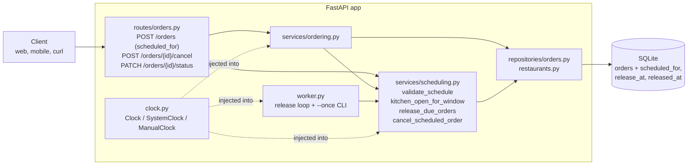
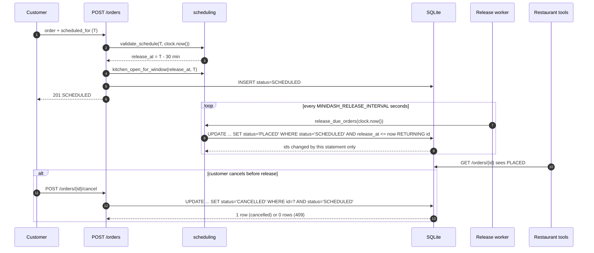

# Design — Track A: Scheduled Orders

## Components touched

| Layer | File | Change |
|---|---|---|
| Infrastructure | `src/minidash/clock.py` (new) | `Clock` protocol, `SystemClock`, `ManualClock`. |
| Infrastructure | `src/minidash/db.py` | Idempotent `migrate()` that adds three nullable columns and an index to `orders`, for new and baseline databases alike. |
| Infrastructure | `src/minidash/timeutil.py` (new) | Fixed-width UTC timestamp format so SQL string comparison equals time comparison. |
| Domain | `src/minidash/services/scheduling.py` (new) | Pure rules (`validate_schedule`, `kitchen_open_for_window`) and use cases (`release_due_orders`, `cancel_scheduled_order`). |
| Service | `src/minidash/services/ordering.py` | `place_order` takes `now` (read from the clock by the route) and the business time zone and calls the scheduling rules; `update_status` refuses to touch `SCHEDULED` orders. |
| Repository | `src/minidash/repositories/orders.py` | Schedule fields on insert; state-guarded `release_due`, `cancel_if_scheduled`, `update_status_unless_scheduled`. |
| Routes | `src/minidash/routes/orders.py` | Optional `scheduled_for` on `POST /orders`; new `POST /orders/{id}/cancel`. |
| Worker | `src/minidash/worker.py` (new) | Background release loop started by the app's lifespan, and a `--once` CLI. |
| App | `src/minidash/app.py` | Accepts `clock`, `business_tz` and `release_interval`; stores them on `app.state`. |
| Routes (stretch) | `src/minidash/routes/web.py` (new) | Serves the page at `/` and its files at `/static`; `GET /config` gives the page the rules, the restaurant time zone and the server's clock. |
| Page (stretch) | `src/minidash/web/` (new) | `index.html`, `styles.css`, `app.js` (DOM and API calls), `logic.js` (pure time and rule helpers, tested in Node). |

The layering rule from the baseline is kept: routes parse HTTP and call services; services own rules and
transactions; repositories own SQL. Only the domain module knows about the 45-minute, 7-day and
30-minute numbers.



## Interfaces

### `POST /orders` (extended)

```json
{
  "restaurant_id": 1,
  "items": [{"menu_item_id": 1, "quantity": 2}],
  "address": "1 Main St",
  "scheduled_for": "2026-10-24T19:00:00-04:00"
}
```

`scheduled_for` is optional. Response 201 adds `scheduled_for`, `release_at`, `released_at`
(UTC, `YYYY-MM-DDTHH:MM:SS.ffffff+00:00`). Errors: 404 `RESTAURANT_NOT_FOUND`, 422 `ITEM_NOT_ON_MENU`,
`SCHEDULE_TIMEZONE_REQUIRED`, `SCHEDULE_TOO_SOON`, `SCHEDULE_TOO_FAR`, `RESTAURANT_CLOSED`.

### `POST /orders/{id}/cancel` (new)

No body. 200 with the order (status `CANCELLED`); 404 `ORDER_NOT_FOUND`; 409 `ORDER_NOT_CANCELLABLE`
when the order is not `SCHEDULED`. A `POST` sub-resource is used rather than `PATCH status=CANCELLED`
so that the "only before release" rule lives in one place and the status endpoint stays a restaurant
and driver tool.

### `PATCH /orders/{id}/status` (guarded)

409 `ORDER_IS_SCHEDULED` if the order is `SCHEDULED`; 422 `STATUS_NOT_SETTABLE` if the body asks for
`SCHEDULED`. Otherwise unchanged from the baseline.

### Domain functions

```python
validate_schedule(scheduled_for: datetime, now: datetime) -> datetime   # returns release_at (UTC)
kitchen_open_for_window(opens_at: str, closes_at: str,
                        start: datetime, end: datetime, tz: ZoneInfo) -> bool
release_due_orders(conn, now: datetime) -> list[int]                    # ids released by this call
cancel_scheduled_order(conn, order_id: int) -> None    # raises 404 / 409
```

## Data changes

```sql
ALTER TABLE orders ADD COLUMN scheduled_for TEXT;   -- UTC, fixed width, NULL for immediate orders
ALTER TABLE orders ADD COLUMN release_at   TEXT;    -- scheduled_for - 30 min
ALTER TABLE orders ADD COLUMN released_at  TEXT;    -- set once, by the release job
CREATE INDEX IF NOT EXISTS idx_orders_status_release ON orders(status, release_at);
```

Both new and existing baseline databases get the columns from one migration, `db.migrate()`, which
checks `PRAGMA table_info(orders)` first, so it is safe to run on every start and there is a single
code path for both.

All stored times use one format, `2026-10-24T23:00:00.000000+00:00`. Because every value is UTC and
the same width, `release_at <= :now` compares correctly as text.

## Release flow



## Error handling

- Rule failures raise `DomainError(code, message, status)`, mapped to JSON by one exception handler.
- The release loop catches and logs any exception from a run and keeps going. A crash in one run must
  not stop all future releases.
- The state guard is in the `WHERE` clause of every write, not in a read before the write, so there is
  no check-then-act race between the worker, cancel and PATCH.

---

## ADR-001: How scheduled orders are released

**Status:** Accepted

**Context.** A scheduled order must move from `SCHEDULED` to `PLACED` at `release_at`, exactly once,
including after a restart, and tests must control time. The stack is one FastAPI process on SQLite, and
the brief asks for minimal dependencies.

**Options considered**

| Option | How it works | For | Against |
|---|---|---|---|
| A. Polling loop + state-guarded `UPDATE` | A background task runs `UPDATE ... WHERE status='SCHEDULED' AND release_at <= now` every N seconds. | No new dependency. Survives restarts (state is in the DB). Exactly-once comes from the `WHERE` clause, so a second worker or a cron run is harmless. Easy to test: call one function with a `ManualClock`. | Release can be up to N seconds late. The process polls even when nothing is due (one indexed query). |
| B. One in-memory timer per order (`loop.call_at`) | Schedule a callback when the order is placed. | Fires on time with no polling. | Timers vanish on restart and must be rebuilt from the DB, which is option A's query anyway. Two app processes would each fire. Hard to test without real waiting. |
| C. Scheduler library or queue (APScheduler, Celery + Redis) | Delegate timing to a job system. | Mature retry and monitoring. | New dependencies and, for Celery, a broker to run. Still needs the state guard for exactly-once. Too heavy for a five-endpoint service. |
| D. Release lazily on read | Release due orders when someone reads an order or the kitchen queue. | No background work. | A `GET` with side effects. Nothing is released if nobody reads. Release time depends on traffic. |

**Decision.** Option A. Default interval 15 seconds (`MINIDASH_RELEASE_INTERVAL`, `0` disables the loop).
The same function is exposed as `python -m minidash.worker --once` for running from cron instead.

**Consequences.** Kitchens may see an order up to 15 seconds after `release_at`; with a 30-minute lead
that is acceptable. Correctness does not depend on the loop running exactly once per process, which also
covers the case of `uvicorn --workers 2`. If MiniDash moves to Postgres, the same `UPDATE ... RETURNING`
works unchanged.

## ADR-002: What "restaurant is closed" means for a scheduled time

**Status:** Accepted

**Context.** Restaurants store `opens_at`/`closes_at` as local `HH:MM` strings with no time zone and no
day-of-week. One seeded restaurant is open 18:00–02:00, across midnight.

**Options considered.** (1) Check only `scheduled_for`. (2) Check only `release_at`. (3) Require the whole
kitchen window `[release_at, scheduled_for]` to sit inside one opening interval.

**Decision.** Option 3, using one business time zone (`MINIDASH_TZ`, default `America/New_York`).
`opens_at == closes_at` means open all day. Both ends are inclusive: release exactly at opening and
delivery exactly at closing are allowed. Comparisons are done after converting to UTC, because Python
compares two datetimes with the same `tzinfo` by wall time and gets daylight-saving transitions wrong.

**Consequences.** The earliest possible delivery is 30 minutes after opening. On Windows, `zoneinfo`
needs the `tzdata` package, so it is listed in `requirements.txt` with a Windows-only marker.

---

## Customer page (stretch goal)

The page is static files served by the same FastAPI app, so it needs no build step, no extra server
and no new dependency. It talks only to the public API plus one new read-only endpoint:

```
GET /config -> {"now": "<server clock, UTC>", "business_timezone": "America/New_York",
                "min_lead_minutes": 45, "max_horizon_days": 7, "release_before_minutes": 30}
```

- **No duplicated numbers.** The page reads the three rule values from `/config`, which takes them
  from `services/scheduling.py`. A test changes `MIN_LEAD` and checks `/config` follows.
- **Server time, not browser time.** The page keeps the difference between `now` and the browser's
  clock, so hints agree with the server even under a `ManualClock` (demo, tests) or a wrong laptop
  clock.
- **Restaurant time zone.** Customers pick a date and time in `business_timezone`. `logic.js` converts
  that wall time to an instant with `Intl` (no date library), using the same fold=0 rule as Python
  for the repeated and skipped hours, and sends it as UTC (`...Z`).
- **The server still decides.** `scheduleHint` mirrors the server's rules only to warn early; every
  order goes to `POST /orders`, and API error codes are turned into plain sentences.
- **Tracking.** The page remembers the order numbers it placed (browser storage, wrapped in
  `try/catch`; in memory if storage is blocked) and polls `GET /orders/{id}` every 3 seconds until
  each order reaches a final status.

## ADR-003: How to build the customer page

**Status:** Accepted

**Options considered.** (1) A React or Vue app with a bundler: rich tooling, but a Node build step and
a dependency tree to audit for a page with three panels. (2) Server-rendered templates (Jinja2): good
for forms, but a new Python dependency and a full reload for each status change. (3) Plain HTML, CSS
and JavaScript modules served by FastAPI's `StaticFiles`.

**Decision.** Option 3. It adds no package, runs from `uvicorn` alone, and keeps the logic worth
testing in one pure module (`logic.js`) that Node's built-in test runner can test without a browser.
A Playwright browser test covers the wiring when Playwright is installed.

**Consequences.** No component framework, so `app.js` builds the DOM by hand and must avoid
`innerHTML` with server data (it uses `textContent`). Node is needed to run the JavaScript unit tests;
pytest skips them, with a reason, where Node is missing.
